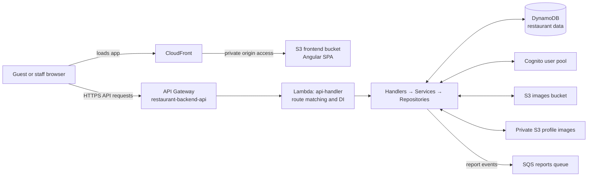
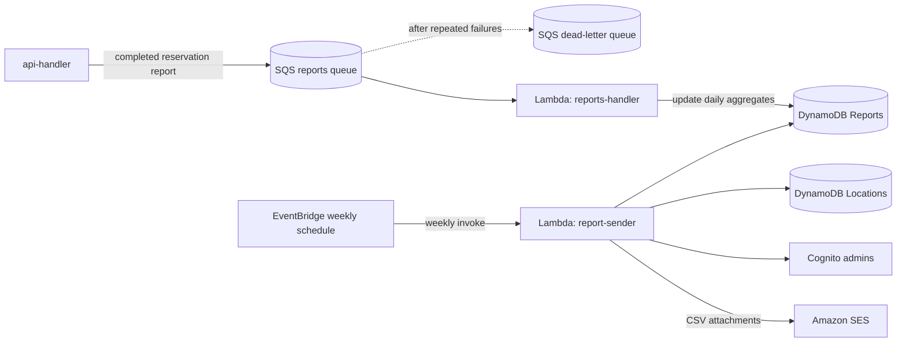

# Repository Architecture

This repository contains the Green & Tasty restaurant application: an Angular client, a .NET AWS Lambda backend, and AWS infrastructure split between Terraform and AWS Syndicate.

## Runtime Overview

The Angular app is a static SPA. Its services use the configured API base URL; the HTTP interceptor attaches the Cognito ID token for normal authenticated calls. Guest-session URLs are intentionally left untouched by that interceptor because guest flows use a separate session token. API Gateway routes invoke the same `api-handler` Lambda; some methods use a Cognito authorizer, while others are public and authorization is handled by application code where needed.

Inside `api-handler`, `FunctionHandler` matches the HTTP method and path against `RouteRegistry`. A matched route invokes a handler, which coordinates domain services and repositories. Those repositories access DynamoDB and AWS services through the clients registered in the route registry.

## Reporting Flow

The API produces per-reservation report messages. The SQS-triggered worker updates daily waiter aggregates; failed messages can move to the queue's dead-letter queue after retries. Separately, the weekly schedule invokes `report-sender`, which reads aggregates and locations, finds administrator emails in Cognito, and sends CSV reports through SES.

## Deployment Ownership

| Area | Owns | Main files |
| --- | --- | --- |
| Terraform | Shared AWS foundation: CloudFront, frontend and image buckets, Cognito, report queue/DLQ, weekly schedule, and scheduler IAM | [`infra/terraform`](infra/terraform) |
| AWS Syndicate | Backend API Gateway, Lambda functions, DynamoDB tables, Lambda roles, and Lambda configuration | [`backend/restaurant-backend-app/deployment_resources.json`](backend/restaurant-backend-app/deployment_resources.json), `backend/restaurant-backend-app/dnapp/lambdas/*/` |
| Angular build/deploy | Production SPA bundle uploaded to Terraform's private frontend bucket | [`frontend/restaurant-frontend-app`](frontend/restaurant-frontend-app) |

Deploy in this order: Terraform infrastructure, backend with Syndicate, then the frontend bundle. The production frontend is built with the deployed API Gateway URL and served through CloudFront. Terraform manages only part of the AWS estate; do not assume every AWS resource is declared in Terraform.

## Where to Trace a Change

- UI routes and screens: [`frontend/restaurant-frontend-app/src/app/app.routes.ts`](frontend/restaurant-frontend-app/src/app/app.routes.ts)
- API URL, HTTP setup, and token handling: [`frontend/restaurant-frontend-app/src/app/app.config.ts`](frontend/restaurant-frontend-app/src/app/app.config.ts), `src/app/auth/token.interceptor.ts`
- API entry point and route composition: [`backend/restaurant-backend-app/dnapp/lambdas/api-handler/Function.cs`](backend/restaurant-backend-app/dnapp/lambdas/api-handler/Function.cs), [`backend/restaurant-backend-app/dnapp/lambdas/api-handler/Routing/RouteRegistry.cs`](backend/restaurant-backend-app/dnapp/lambdas/api-handler/Routing/RouteRegistry.cs)
- HTTP contract: [`backend/restaurant-backend-app/docs/ApiRoutes.md`](backend/restaurant-backend-app/docs/ApiRoutes.md)
- AWS resource definitions: [`infra/terraform`](infra/terraform) and [`backend/restaurant-backend-app/deployment_resources.json`](backend/restaurant-backend-app/deployment_resources.json)

## Repository Map

- `frontend/restaurant-frontend-app`: Angular UI, auth, pages, API services, and frontend tests.
- `backend/restaurant-backend-app/dnapp/lambdas/api-handler`: synchronous API, domain handlers/services/repositories, and AWS clients.
- `backend/restaurant-backend-app/dnapp/lambdas/reports-handler`: asynchronous SQS consumer for daily report aggregates.
- `backend/restaurant-backend-app/dnapp/lambdas/report-sender`: scheduled weekly CSV report generation and email delivery.
- `backend/restaurant-backend-app/Tests`: .NET service tests.
- `infra/terraform`: shared infrastructure definitions.
- Root Markdown files and `backend/restaurant-backend-app/docs`: setup, deployment, API, domain diagrams, and migration notes.